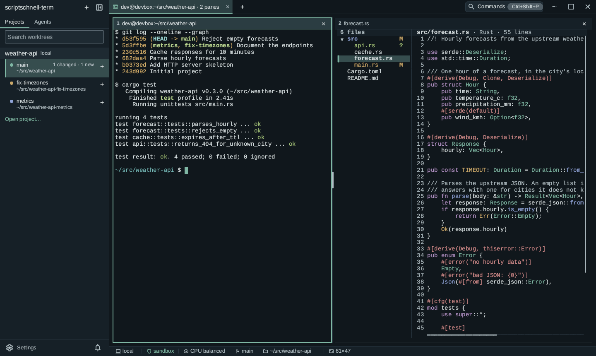

# scriptschnell-term

scriptschnell-term is a native, GPU-rendered workspace of terminal and browser panels
organized by version-control project and worktree (Git, Mercurial and optional Jujutsu).
Worktrees run locally, over SSH, on remote machines or VMs, in devcontainers or in
sandboxes, with built-in coding agent integrations and Lua extensions.



Built on [SchnellUI](https://github.com/codefionn/schnellui), `cmdterm-vt`,
[Oximond](https://github.com/codefionn/oximond) (Lua) and optional Servo browser panels.

## Run it

```sh
cargo run --release -p cmdterm -- ~/src/myrepo devbox:/srv/service
cargo run --release -p cmdterm --features browser       # with Servo browser panels
cargo build --release -p cmdterm --no-default-features  # shipped extensions only
```

Pass one or more locations to open on startup: a local path, `host:/path` or
`ssh://[user@]host[:port]/path`, `cmdterm://host[:port]/path`, `vm://name/path`, or a
repository URL to clone.

## Core usage

- **Projects and worktrees**: the left rail lists your projects and the selected
  project's worktrees. Switching worktrees restores that worktree's panels while other
  worktrees keep running in the background.
- **Command palette (`Ctrl+Shift+P` or `+` in the rail)**: open or clone projects,
  create or remove worktrees, switch worktree runtimes (sandbox, devcontainer or host),
  open panels and run commands. Type to filter, `Up`/`Down` to pick, `Enter` to run,
  `Escape` to close.
- **Sidebar search (`Ctrl+Shift+S`)**: filter every project's worktrees by agent session
  titles, branches, change requests or folder names.
- **Settings (`Ctrl+,`)**: configure fonts, color schemes, keymaps, sandboxes, coding
  agents, forge accounts, remote machines, VMs and extensions.

### Essential shortcuts

Default `cmdterm` keymap (switch presets or rebind on **Settings > Keyboard**):

| Keys | Action |
| --- | --- |
| `Ctrl+Shift+P` | Command palette |
| `Ctrl+,` | Settings |
| `Ctrl+Shift+S` | Search worktrees in sidebar |
| `Ctrl+Shift+T` | New shell in a new tab |
| `Ctrl+Shift+A` | Start default coding agent in a new tab |
| `Ctrl+Shift+D` / `Ctrl+Shift+E` | Split pane side by side / stacked |
| `Ctrl+Shift+O` / `Ctrl+Shift+I` | Focus next / previous pane |
| `Ctrl+Shift+X` / `Ctrl+Shift+W` | Close focused pane / close tab |
| `Ctrl+PageDown` / `Ctrl+PageUp` | Next / previous tab |
| `Ctrl+Shift+F` | Browse worktree files |
| `Ctrl+Shift+H` / `Ctrl+Shift+R` | Explore commit history / review changes |
| `Ctrl+Shift+C` / `Ctrl+Shift+V` | Copy selection / paste (including images) |

## Documentation

See the [documentation index](docs/README.md) or jump straight to a guide:

- [Workspace, projects and worktrees](docs/workspace.md)
- [Built-in panels](docs/panels.md) (file browser, history, review, change requests, debug browser, machine monitor)
- [Keybindings and keymaps](docs/keybindings.md)
- [Sandboxes and devcontainers](docs/sandboxes.md)
- [Coding agents](docs/agents.md) (hooks, skills, control socket, multi-agent coordination, MCP tools)
- [Remote machines, SSH, VMs and web access](docs/remote.md)
- [Extensions](docs/extensions.md) (Lua/Teal extensions and shipped extensions)

Reference and project docs:

- [Configuration reference](crates/cmdterm/CONFIGURATION.md) (`settings.json`, `state.json`, CLI flags, env vars, control API)
- [Extension API reference](crates/cmdterm/src/ext/README.md)
- [SOUL.md](SOUL.md), [AGENTS.md](AGENTS.md), [CHANGELOG.md](CHANGELOG.md)

## License

Licensed under either of

- Apache License, Version 2.0 ([LICENSE-APACHE](LICENSE-APACHE) or <http://www.apache.org/licenses/LICENSE-2.0>)
- MIT license ([LICENSE-MIT](LICENSE-MIT) or <http://opensource.org/licenses/MIT>)

at your option.

Unless you explicitly state otherwise, any contribution intentionally submitted
for inclusion in this work by you, as defined in the Apache-2.0 license, shall
be dual licensed as above, without any additional terms or conditions.
